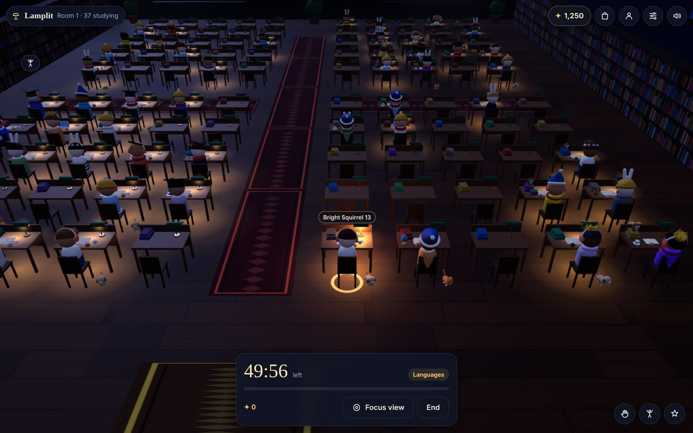
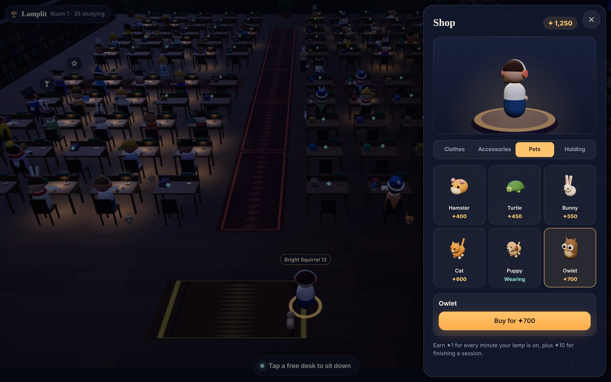
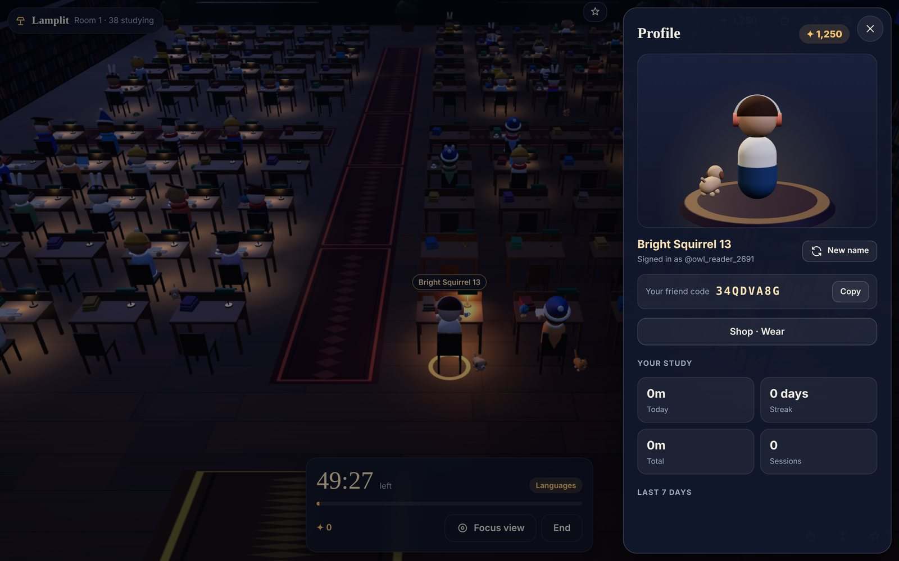
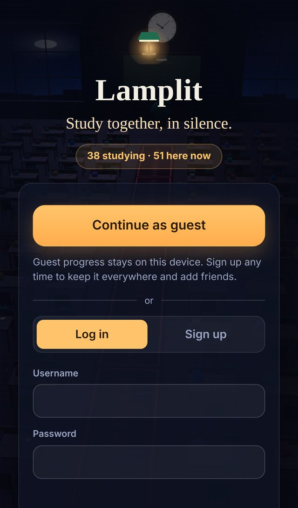
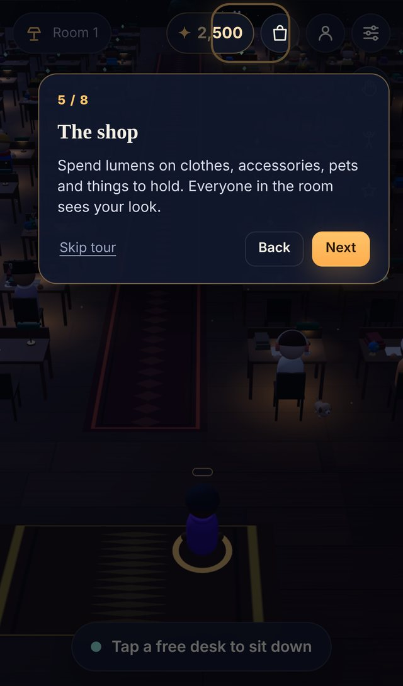

# Lamplit — study together, in silence

A browser-based online study hall. You walk into a night-time reading room as a little
student, take a free desk, pick how long you want to focus, and **turn on your desk lamp**.
Everyone else in the room is doing the same. You can see their lamps glowing, but there is
**no chat** — just the quiet company of other people working.

Every minute your lamp is on earns **lumens (✦)**. Spend them in the **shop** on clothes,
accessories, pets and things to hold; everyone in the room sees your look. Play as a guest
straight away, or create an account to keep your progress everywhere and add friends.



| The shop, with a 3D try-on | Your profile |
|---|---|
|  |  |

<p align="center">
  
  
</p>

Lamplit is an original game in the "quiet shared space" genre that online temples such as
Sansa made popular in 2026. It aims that idea at studying and gives people a reason to come
back every day. Its name, setting, characters, items, art and sound are all its own.

## Quick start

Requires Node.js 22 or newer. It uses Node's built-in SQLite, so there's no database to install.

```bash
cd lamplit
npm install
npm start            # http://localhost:8080
```

Accounts, wardrobes and stats are stored in `data/lamplit.db`. Set `DB_PATH` to put the file
somewhere else.

To fill a room with simulated students for a demo, raise the per-IP limits first. Every bot
creates a guest profile and connects from the same address. A higher starting balance lets
the bots buy pets and clothes, which makes the room look lived-in:

```bash
START_LUMENS=2500 AUTH_PER_MIN=100000 AUTH_BURST=100000 MAX_CONN_PER_IP=100000 npm start
npm run bots -- --count 60 --room 1
```

Run the tests (51 tests covering the layout, pathfinding, protocol validation, room logic,
accounts and passwords, the shop and the economy, friends, and a real server with real
HTTP and WebSocket clients):

```bash
npm test
```

## How to play

1. **Continue as a guest**, or log in / sign up. Guests get everything; an account keeps it
   on every device and lets you add friends.
2. On your first visit, a **short tour** shows you around. You can replay it from Settings.
3. **Tap a free desk.** Free desks have a small floating marker. Your student walks over and sits down.
4. Choose a **session length** (25, 50 or 90 minutes, or open-ended) and **what you're working on**.
5. **Turn on the lamp.** It lights up for everyone, and you earn ✦1 a minute while it's on.
6. When the session ends, a bell rings and you get a ✦10 bonus. Take a 5-minute break, start
   another, or stay.

| | |
|---|---|
| **Shop** (bag icon, or tap your ✦ balance) | Clothes, accessories (hats, glasses, ears, neckwear), pets and things to hold, in 38 items. Try anything on the 3D preview before buying. Pets follow you around and settle by your desk; things you hold move onto the desk when you sit. |
| **Profile** (person icon) | Your avatar in 3D (drag to turn it). Also: your name, your account, today/streak/total/sessions, the last 7 days, a daily goal, desk lamps that unlock at 5, 15, 40 and 100 hours, and friends. |
| **Friends** | Accounts have an 8-character friend code. Add someone's code; once they accept, you'll see whether they're studying and in which room, and can **join** them there. |
| **Settings** (sliders icon) | Language, sound, graphics quality, your account (sign up, log in, log out), and the tour. |
| **Focus view** | Zooms in on your desk and hides everything except the timer. |
| **Wave, stretch, cheer** | The three buttons at the bottom right (top right on phones). |
| **Send a cup of tea** | Tap someone's desk to see what they're working on and leave them a cup of tea. |
| **Rooms** | Each room holds 100 people. Tap the room name to see the others and move. |
| **Languages** | English and Korean. Names, subjects and items appear in each viewer's own language. |

### Why there's no chat

Not having chat is the point. It's also why the game needs no moderation:
- In the room, names come from fixed word lists, subjects from a fixed list, and the only
  gestures are wave, stretch, cheer and tea. Nobody can type anything that anyone else sees.
- Usernames are only used to log in and are never shown to other players. Friends find each
  other by friend code.

### The economy

| | |
|---|---|
| Earning | ✦1 per minute of focus, plus ✦10 for finishing a timed session. New profiles start with ✦100. |
| Who keeps the books | The server: it credits focus time from its own clock, checks every purchase against your balance in a database transaction, and only lets you wear what you own. |
| Money | There is no real-money payment anywhere. |

## How it works

```
lamplit/
├── server/
│   ├── index.js        entry point (npm start)
│   ├── app.js          HTTP + WebSocket wiring, per-IP limits, heartbeats, rate limits
│   ├── api.js          sign-in endpoints: guest, sign up, log in, log out, me
│   ├── halls.js        all room logic, independent of sockets (tested directly)
│   ├── profiles.js     accounts, lumens, buying and wearing, friends
│   ├── accounts.js     password hashing (scrypt), usernames, calendar days per time zone
│   ├── db.js           SQLite storage (node:sqlite)
│   ├── static.js       static files with ETags and cached brotli/gzip
│   ├── rate-limit.js   token bucket
│   └── config.js       environment variables
├── shared/             used by both the server and the browser
│   ├── layout.js       room geometry: 100 desks, shelves, walk grid
│   ├── path.js         A* pathfinding with smoothing
│   ├── protocol.js     message types, limits and validation
│   ├── catalog.js      the shop: items, slots, prices, looks
│   └── words.js        names, subjects, colours, lamps (English + Korean)
├── client/
│   ├── index.html, style.css, icon.svg
│   ├── vendor/three.module.min.js   three.js r169 (MIT)
│   └── js/
│       ├── main.js      ties everything together
│       ├── world.js     the room, instanced desks/lamps, lamp glow, clock and board
│       ├── avatars.js   instanced students, their clothes, items and pets
│       ├── look.js      3D recipes for every shop item, built from simple shapes
│       ├── preview.js   the 3D avatar stage (profile, shop) and shop thumbnails
│       ├── ui.js, views.js   header, dock, sheets (shop, profile, settings...), sign-in
│       ├── tutorial.js  the first-visit tour
│       ├── api.js, net.js    sign-in requests; WebSocket with reconnects and clock sync
│       ├── audio.js     Web Audio synthesis
│       └── store.js, i18n.js, labels.js, icons.js, textures.js
├── tools/bots.js       simulated visitors for demos and load tests
└── tests/              node --test suites
```

**Signing in.**
- Every visitor has a profile in the database. A guest is simply a profile without a username.
- Signing up adds a username and password to the *same* profile, so a guest keeps everything they earned.
- Passwords are hashed with scrypt and a per-user salt.
- Logins are random 256-bit tokens. Only their SHA-256 is stored, they last 90 days, and they're sent in the `Authorization` header (never in URLs or cookies).
- Sign-in endpoints are rate-limited per IP address.

**The server is authoritative.**
- Desks are claimed on the server, so two people can never take the same seat.
- Paths are computed on the server and broadcast; clients only replay them.
- Focus minutes and lumens are credited from the server's own clock.
- Every incoming message is validated in `shared/protocol.js`, and one bad message can never take the process down.

**Rooms and seats.**
- Each room holds up to 100 people, one per desk.
- New visitors join the busiest room that still has space.
- When every room is full, a new one opens, up to `MAX_HALLS`; after that, visitors wait in a queue.
- If your connection drops, you keep your desk and session for 2 minutes. Logging in again (or opening a second tab) takes over your seat.

**Rendering.**
- Each kind of desk part, body part and shop item is drawn once for the whole room (instancing), however many people wear it. About 40 item types cost about 40 draw calls.
- Lamp glow is fake light (additive sprites).
- The 3D preview and the shop thumbnails share one extra WebGL context. Browsers cap live contexts and drop the oldest, which would be the room itself.

### Measured performance

Measured in a 4-vCPU container with the server and the bots on the same machine (before
accounts were added; a guest sign-in is one small database insert):

| | |
|---|---|
| First page load | about **200 KB** compressed in total, including three.js (151 KB brotli) |
| 6,000 simulated students in 61 rooms, steady state | server at about **5–10% of one CPU core**, about 150 bytes/second per student |
| The same 6,000 joining at 600 per second | server peaks at about 85% of one core; p50 join time 286 ms, p95 730 ms |

## Configuration

| Variable | Default | |
|---|---|---|
| `PORT` | `8080` | |
| `HOST` | `0.0.0.0` | |
| `DB_PATH` | `data/lamplit.db` | SQLite file (`:memory:` keeps nothing) |
| `START_LUMENS` | `100` | lumens a new profile starts with |
| `AUTH_PER_MIN` / `AUTH_BURST` | `10` / `20` | guest, sign-up and log-in requests per IP: rate per minute and burst |
| `HALL_CAPACITY` | `100` | people per room (at most 100, the number of desks) |
| `MAX_HALLS` | `100` | rooms per server process before visitors queue |
| `MAX_QUEUE` | `5000` | queue length before visitors are turned away |
| `TICK_MS` | `200` | how often room events are sent |
| `MAX_CONN_PER_IP` | `40` | sockets per IP address (schools and offices share addresses) |
| `TRUST_PROXY` | off | set to `1` behind a reverse proxy so `X-Forwarded-For` is used |
| `ALLOWED_ORIGINS` | any | comma-separated list of allowed `Origin` values for the WebSocket |

## Deploying

Any host that runs Node and allows WebSockets will work: a small VPS, Fly.io, Render,
Railway and so on.

1. Give it a persistent disk for `DB_PATH`.
2. Put it behind HTTPS so passwords and tokens travel encrypted.
3. Set `TRUST_PROXY=1` if a proxy sits in front, so rate limits see real addresses.

Room state (who's sitting where) lives in memory, so a restart empties the rooms. Accounts,
lumens, wardrobes and stats live in the database and survive restarts.

## Known limits and next steps

- **One process.** Going past one process's rooms (about 10,000 people at the defaults) needs a router that sends each room to a process, with shared presence for the friends list (for example Redis).
- **No password reset.** There are no emails, so a forgotten password can't be recovered yet.
- **No moderation tools.** None are needed while nobody can type anything others see. Keep that rule if you add features.
- **Background timers.** Browsers slow down timers in background tabs. The server finishes a session on time either way, but the bell can be late if the tab is hidden and muted.
- **Ideas:**
  - seasonal items and events (a New Year wish hill)
  - friend study groups
  - more room themes
  - notifications when a session ends
  - mini-app versions (Toss, LINE)

## License

MIT, same as the rest of this repository. three.js is MIT-licensed
(`client/vendor/THREE_LICENSE.txt`). The `ws` package is MIT-licensed.
